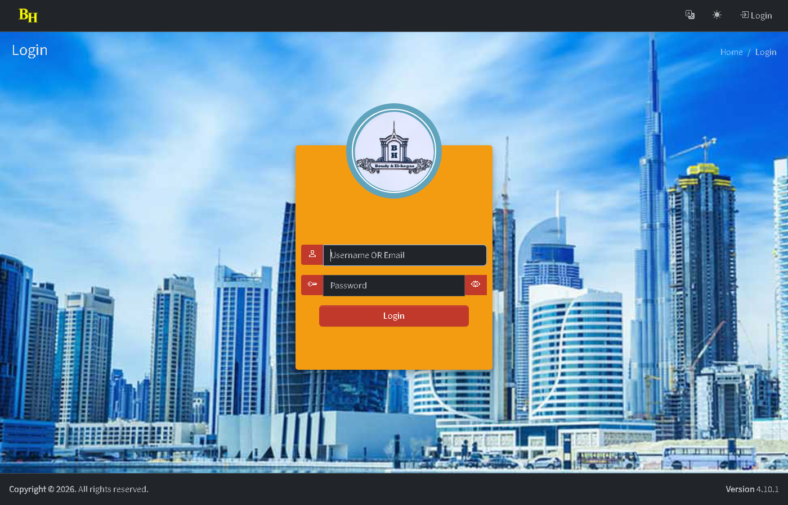
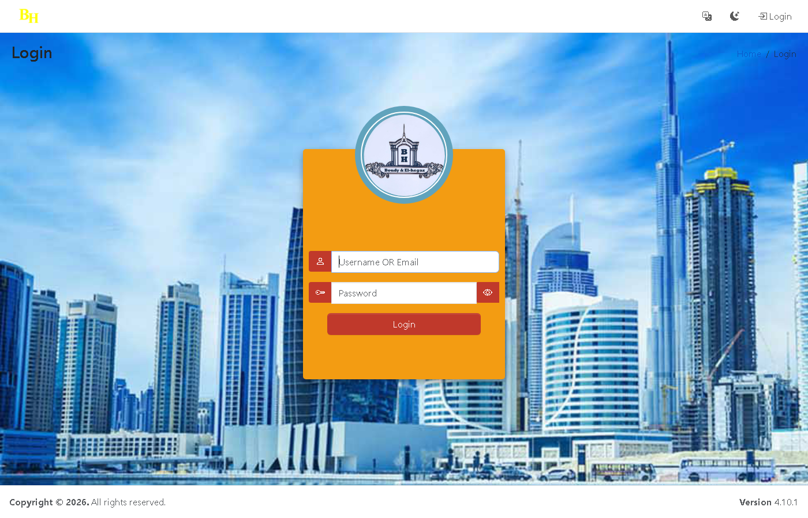

# EH_CRM

A CRM plugin for UserSpice — built for a real-estate marketing company.

**Features:**
- Data entry from CSV (template + review before registration)
- Equal distribution of leads to the sales team
- Per-lead call logging with results and follow-up dates
- Sales manager dashboard: monitoring, transfer, recycling of cold leads
- Reports with KPIs, charts, and CSV export
- Admin settings: call results, sources, projects, team profiles, distribution rules
- Supervisor control panel (create/edit/block users, manage permissions)
- Bilingual UI (Arabic / English) with automatic RTL/LTR

## Screenshots

### Dashboard (Light)


### Dashboard (Dark)


### Login


## Requirements

- UserSpice 6.1.6+
- PHP 7.4+ (8.x recommended)
- MySQL / MariaDB
- Tested on 6.1.7

## Install

1. Copy the `eh_crm/` folder into `usersc/plugins/`.
2. Run `usersc/plugins/eh_crm/install.php` (master account) — registers the plugin and deploys pages.
3. Run the SQL files in `sql/` in order (001 → 010) via phpMyAdmin.
4. Activate the plugin from **Admin → Plugins**.
5. (Optional) Open **CRM → Configure** to create the 4 CRM permissions and the menu.

## Permissions

The plugin uses 4 named permissions (created via Configure, or pre-existing):

| Permission | Role |
|---|---|
| CRM Data Entry | Data entry operator |
| CRM Sales | Sales rep |
| CRM Sales Manager | Sales manager (sees all, distributes, transfers) |
| CRM Supervisor | Supervisor (manages users via CEO_Control) |

Permission IDs are resolved by **name**, so they work regardless of the actual ID number in your UserSpice install.

## Menu

Menu creation is **optional** and done from the Configure page (idempotent — safe to run multiple times). The menu uses lang keys as labels, so it follows the site language (Arabic/English).

## Structure

```
eh_crm/
├── info.xml
├── functions.php        (auto-loaded; deploys pages, loads lang)
├── activate.php / install.php / migrate.php / update.php / uninstall.php / configure.php
├── footer.php
├── assets/
│   ├── pages/           (13 pages — deployed to usersc/ on install)
│   ├── js/crm.js        (deployed to usersc/assets/crm.js)
│   └── leads_template.csv
├── ajax/                (data_in_.php, show_data_.php — deployed to usersc/scripts/)
├── lib/                 (crm_boot, crm_func, crm_admin, crm_assign, crm_csv, crm_calls, crm_reports, crm_leads, SimpleXLSXGen)
├── lang/                (ar-EG, ar-SA, en-US — 441 CRM_ keys)
└── sql/                 (001..010)
```

## Tables (prefix: `eh_crm_`)

`eh_crm_settings`, `eh_crm_sources`, `eh_crm_projects`, `eh_crm_call_results`, `eh_crm_sales_profile`, `eh_crm_import_batches`, `eh_crm_import_staging`, `eh_crm_leads`, `eh_crm_lead_assignments`, `eh_crm_call_logs`, `eh_crm_activity_log`, `eh_crm_page_move`

## Language

- 441 `CRM_*` keys in 3 languages (Arabic EG/SA, English).
- Merged into `$lang` at runtime by `crm_load_lang()` (in functions.php).
- Menu items use lang keys as labels (resolved by `parseMenuLabel()`).

## Update

```bash
cd usersc/plugins/eh_crm
git pull origin main
# deploy_pages() auto-copies updated pages on next page load
```

## License

MIT (or as specified by the author).

## Author

Emad Helmy — https://userspice.com
